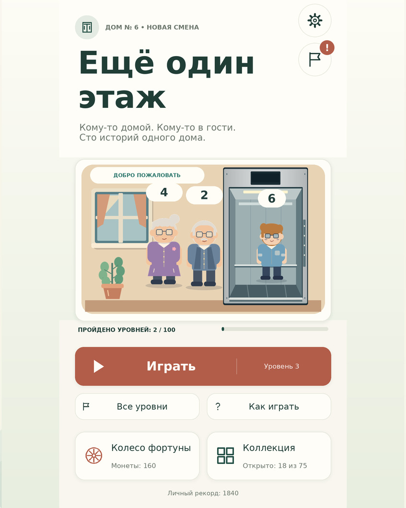

# Исправление огромных круглых кнопок

Исправлены шестерёнка и флажок в главном меню, а также стрелки страниц достижений. Они снова занимают небольшие отдельные области и не закрывают иллюстрацию, карточки и надписи.

Причина была в последнем изменении: `AspectRatioFitter.FitInParent` находился на кнопках, прямым родителем которых была общая экранная панель. В Unity этот режим управляет якорями и размером дочернего элемента по **всему родителю**. Ранее заданные маленькие якорные области кнопок заменялись размером панели; кнопки оказывались огромными и совпадали в центре.

Теперь каждая круглая кнопка находится внутри собственного небольшого `RectTransform`-контейнера. Подгонка круга работает только внутри него. Доступность стрелок, переходы страниц, значок новых наград, настройки и достижения сохраняют свои обработчики. Сохранения, баланс, темы и игровые правила не менялись.

## Проверка

Сначала исправлена ошибка в диагностическом заменителе SDK: он неверно моделировал `FitInParent`, ограничивая круг прежней областью самого элемента. После приведения к контракту Unity прежний код воспроизвёл наложение кнопок и провалил проверку. Исправленный код проходит её.

- **295 проверок UI с заменителями SDK**, включая все страницы обеих категорий достижений в двух темах. Проверяется, что стрелки остаются ниже карточек и по разным углам, а кнопки меню остаются небольшими отдельными кругами.
- Размеры проверок: 360×640, 360×800, 390×844, 430×932, а также **542×678, 862×667 и 986×659** со скриншотов пользователя. Учитываются безопасные отступы.
- Синтаксис C# 9: **45 файлов × 5 конфигураций**, ошибок 0.
- Диагностические раскладки: 280 вариантов в четырёх размерах окна и двух темах, без кандидатов на переполнение текста по метрикам шрифтов.
- Повторные симуляции игровой логики не требовались: изменена только иерархия круглых кнопок и проверяющий её диагностический код.

[Первая страница достижений](Docs/UIFix/achievements-page1.jpg) · [Вторая страница](Docs/UIFix/achievements-page2.jpg)

Это предпросмотры из фактического C# и ресурсов, **не скриншоты Unity**. Unity Editor в этой среде отсутствует; Play Mode и сборка Android здесь не выполнялись.

Распакуйте исправленный архив и откройте `OPEN_GAME.cmd`. Если переносите исправление в уже изменённый вами проект, рабочее изменение находится в `Assets/OneMoreFloor/Runtime/AchievementScreens.cs`; его прежний `.meta` сохранён. Пересоздавать сцену и удалять сохранения не требуется.
