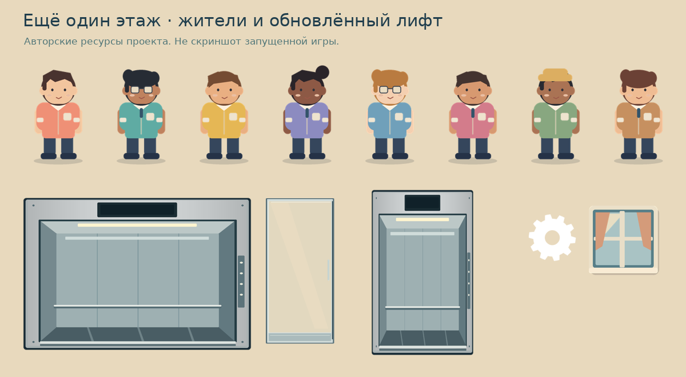
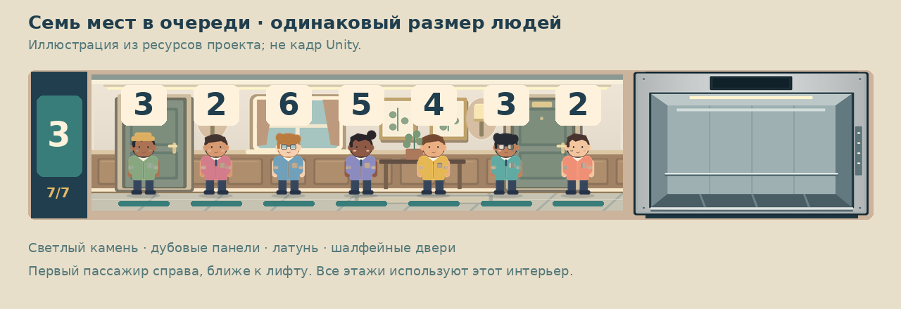

# Ещё один этаж

Кампания из 50 уровней портретной 2D-игры на C# для Android с совместимой с iOS игровой логикой. Без платных ассетов, рекламы и внешних сервисов. Оформление — авторская 2D-графика в тёплой палитре: восемь вариантов соседей, дом в разрезе с окнами, растениями, крышей и шахтой лифта, металлическая кабина со стеклянными раздвижными дверями. Все PNG включены в проект и не требуют покупки или скачивания ассетов.

## Семь языков

Первый экран на английском предлагает обязательный выбор языка перед обучением. Включены English, Русский, Türkçe, Español, Deutsch, Français и 简体中文 (упрощённый китайский). Выбор сохраняется. В настройках его можно изменить на паузе без перезапуска попытки. Переведены все игровые экраны, 50 названий уровней и сообщения. 157 записей × 7 языков хранятся локально, сети и нового пакета нет. [Открытие, обновление и проверка языков](Docs/LANGUAGES.md).

## Что изменилось в оформлении

- Люди с лицами, волосами, разным цветом кожи и одеждой. Внешность случайна. С третьего уровня встречается сосед с коробкой: ему нужны два места вместо одного.
- Номер нужного этажа находится в пузыре над головой. Под ногами ожидающего — полоса терпения; в кабине полоса скрывается, номер сохраняется.
- Один и тот же персонаж перемещается из очереди в лифт. Есть плавное появление, покачивание при ходьбе, исчезновение при уходе и надпись «Спасибо!» после доставки.
- Дом в разрезе: шесть коридоров, окна с занавесками, картины, светильники, растения, крыша, фундамент и дальний городской фон. Нажимать можно как на номер этажа, так и на сам коридор.
- Лифт с направляющими, подсветкой, табло, раздвижными стеклянными дверями и плавным разгоном/торможением. Через стекло видны люди и их цели.
- Главное меню с кнопкой «Как играть? Обучение». Первый уровень обучает прямо во время игры: стрелки ведут к случайному пассажиру и его цели. В меню также есть справка из четырёх страниц: цифры и терпение, управление, очки и множитель, кампания. На HUD видны прогресс серии, множитель, заполненность и потери. Полный лифт подсвечивается.
- Шестерёнка в главном меню и игровом HUD открывает настройки. В настройках — переключатель звука с сохранением выбора. Выключение немедленно останавливает уже звучащий сигнал. Из партии настройки открываются через паузу; закрытие возвращает на паузу, а не запускает игру автоматически. Разные негромкие сигналы посадки, доставки, ухода и нажатия сохранены.
- Портретная игровая область центрируется даже в широком Game View; safe area учитывается отдельно.

Это доработанное оформление прототипа. Публикация для потребителя всё ещё требует проверки Play Mode/устройств, баланса и требований магазинов.

## Открытие и запуск

1. Версия проекта — **Unity 6.6, точно 6000.6.7f1**, как в установленном у пользователя редакторе. Unity Hub и активная лицензия Unity по-прежнему нужны. Скачайте полный архив репозитория и распакуйте его в новую папку.
2. Для Android установите модуль **Android Build Support**, включая **Android SDK & NDK Tools** и **OpenJDK**.
3. На Windows дважды нажмите **OPEN_GAME.cmd** рядом с папками Assets, Packages, ProjectSettings. Команда ищет Unity 6000.6.7f1 в стандартной папке Hub и открывает проект напрямую через `-projectPath`, без добавления в список Hub. Также автоматически проверяет путь пользователя `D:\6000.6.7f1\Editor\Unity.exe`. При другой установке предложит указать полный путь к `Unity.exe`. Лог записывается в `Unity-open.log`. Запускать нужно из распакованной папки. Альтернатива: Hub → Add → Add project from disk. Основной файл PlayerSettings включён в проект; Unity создаст остальные стандартные настройки и импортирует встроенный пакет Unity UI. Причина предыдущего отказа Hub на компьютере пользователя по одному сообщению не установлена; смена версии сама по себе не доказывает исправление этого отказа.
4. Включён **Input Manager (Old)** (`activeInputHandler: 0` в PlayerSettings). Если открываете игру внутри другого проекта, в **Edit → Project Settings → Player → Other Settings → Active Input Handling** выберите **Input Manager (Old)** либо **Both**. Если Unity потребует перезапуск, согласитесь. Используется стандартный `StandaloneInputModule`, поддерживающий мышь и касания, пакет Input System не нужен.
5. При первом открытии сцена создаётся автоматически, если игровая сцена отсутствует и редактор открыт на пустой неизменённой сцене. Если этого не произошло, выполните **Ещё один этаж → Создать или открыть игровую сцену**. Команда создаст `Assets/OneMoreFloor/Scenes/Game.unity`, настройки `GameSettings.asset`, камеру, EventSystem и корневой GameApp, добавит сцену в список сборки. Существующая сцена по этому пути только открывается, существующие настройки сохраняются. Несохранённую текущую сцену редактор предложит сохранить.
6. Нажмите **Play**. При первом запуске выберите **Русский → Продолжить** на английском экране Choose your language, затем **Выбрать уровень → 1 → Начать обучение**. Дополнительных ручных привязок компонентов нет. В Game View выберите портретный размер, например 540×960.

UI создаётся при запуске. Откройте «Выбрать уровень», выберите открытый уровень, прочитайте цель и нажмите «Поехали». Существующая сцена Game не требует пересоздания. При обновлении старого GameSettings настройки 50 уровней появляются автоматически; список разбит на десять страниц. Справка «Как играть?» доступна отдельно. Пока открыт выбор уровня, описание или справка, игровая сессия не запущена.

## 50 последовательных уровней

| Уровень | Название | Этажи | Доставить людей | Интервал появления, с | Терпение, с | Коробка | Лимит очереди |
|---|---|---|---:|---|---:|---:|---:|
| 1 | Первый рабочий день | 1–3 | 6 | 3.6 → 3.2 | 80 | Нет | 2 |
| 2 | Знакомые лица | 1–3 | 10 | 3.3 → 3 | 80 | Нет | 3 |
| 3 | Новоселье | 1–4 | 12 | 3.5 → 3.2 | 95 | 20% | 4 |
| 4 | Дом полон историй | 1–5 | 14 | 3.6 → 3.3 | 110 | 23% | 4 |
| 5 | Хозяин лифта | 1–6 | 16 | 3.8 → 3.5 | 120 | 25% | 5 |

Уровни 6–50 используют все шесть этажей и чередуют пять профилей: смешанные поездки, короткие визиты на 1–2 этажа, дальние маршруты через половину дома, небольшие волны (иногда двое сразу) и переезды с большим числом коробок. Цели, темп, терпение и доля коробок отличаются. У всех 50 этапов отдельные названия и разные наборы настроек. [Полная таблица 50 уровней](Docs/LEVELS.md) формируется из кода кампании.

Цель — число **доставленных людей**, указанное сверху. Очки остаются результатом и рекордом; они больше не открывают этажи внутри уровня. После победы следующий уровень открывается и сохраняется немедленно. Поражение и выход в меню не открывают следующий. Пройденные можно переигрывать; после пятидесятого доступны все 50. Сохраняется лучший счёт каждого уровня. Незавершённая попытка после закрытия приложения начинается заново.

Первый пассажир появляется примерно через 0.8 секунды на случайном этаже 1–3, с новым назначением и внешностью. На первом уровне стрелка показывает настоящий этаж этого человека, затем его назначение. До первой доставки никто не теряет терпение и второй пассажир не появляется: обучение можно освоить без спешки. После первой доставки объясняются очки и полоса терпения, начинается обычная генерация. На этом уровне очередь ограничена двумя, чтобы экран не перегружался.

Перед первой попыткой уровня с коробками появляется объяснение. До «Понятно, поехали» пассажиров нет и время не идёт. Человек с коробкой занимает **два из четырёх мест**. Он считается одним человеком при доставке и уходе, получает обычные очки, имеет обычное терпение. В кабине коробке выделяется второй слот, фигура человека остаётся того же размера, стекло и цифра над головой сохраняются. Если места только одно, первая коробка и стоящие за ней остаются ждать: FIFO не нарушается.

Все появления на всех уровнях случайны: этаж равномерно выбирается среди доступных неполных очередей, назначение — среди других открытых этажей с учётом короткого/дальнего профиля, внешность — из восьми вариантов. Коробка выбирается независимо с вероятностью из таблицы, а не по фиксированному расписанию. Её появление в каждой отдельной короткой попытке не гарантируется. Каждый повтор получает новый seed; явный seed в Core оставлен только для воспроизводимых проверок. Интервал дополнительно колеблется на ±15%. Пассажиры появляются по независимому таймеру, включая время движения и посадки. Типичный интервал — 3–4 секунды вместо прежних 7–9. В волновом профиле интервал между волнами немного длиннее, но иногда приходят сразу двое. Если после доставки или ухода дом пуст, следующий пассажир придёт примерно за 0.8 секунды, а не после полного интервала. Исключение — ожидание первой обучающей доставки и исчерпанный запас пассажиров. Одновременно в доме максимум 3–7 человек в зависимости от этапа; ожидающие и едущие считаются вместе. При достижении предела генератор ждёт освобождения места без скрытого накопления. Терпение увеличено с учётом длинных маршрутов и нового темпа. Темп слегка растёт по мере доставок и ограничивается; верхние этажи не включаются от очков. Закрытые этажи затемнены, показывают уровень открытия и игнорируют нажатия.

Запас пассажиров — цель плюс два, поэтому можно потерять до двух и всё равно пройти. Третий уход завершает попытку поражением. Успех показывается сразу по достижении цели, без ожидания оставшихся. При полном доме запланированное появление пропускается без потерь и без расхода запаса пассажиров.

## Общие правила и настройка баланса

Лифт вмещает четыре **места**. На полной остановке сначала выходят люди, затем очередь входит до заполнения мест; внутри терпение заморожено. Текущая поездка неизменна. Последний тап во время движения заменяет только следующую остановку. Можно повторно нажать текущий этаж для новой посадки, если пассажиры появились после остановки.

За доставку — DeliveryPoints × множитель; по умолчанию 10 очков. Первые пять доставок дают ×1, следующие пять ×2, затем ×3. Уход сбрасывает серию, но сохраняет очки. Пауза, настройки и сворачивание останавливают движение, генерацию и терпение; продолжение только явной кнопкой. Рекорд, звук, открытые уровни и знакомство с коробкой сохраняются в PlayerPrefs.

Выберите `Assets/OneMoreFloor/GameSettings.asset` в Project до запуска:

- **Levels** — 50 отдельных настроек: название, Active Floors, Delivery Goal, Queue Limit, Spawn Seconds / Final Spawn Seconds, Patience Seconds, Box Chance, Guided, Traffic, Max Active Passengers и Empty House Delay. Это настройки именно этапов прохождения.
- **Rules** — общие Seconds Per Floor (1.25), Stop Seconds (0.65), Capacity (4), Loss Limit (3), Delivery Points (10), Floors (6).
- Старые поля Rules Patience/InitialSpawn/MinimumSpawn/DifficultyScoreCap/StartingFloors/StartingRouteDistance оставлены для совместимости независимого ядра со старым бесконечным режимом. **Игровой интерфейс использует кампанию, поэтому меняйте терпение/частоту в Levels.**

Глобальный предел очереди — семь. В тестовых уровнях предел ниже (2–5); фигурки и номера всегда одного размера, занимают постоянные места в одном ряду, ничего не сжимается. Поля Floors/Capacity/LossLimit доступны, но оформление и баланс рассчитаны на 6/4/3.

В симуляции простой водитель, реагирующий раз в 1.25 секунды, прошёл 2500 из 2500 раскладов (50 попыток каждого из 50 этапов). Среднее время первых пяти — 25/36/47/58/72 секунды; у последующих оно зависит от типа маршрутов, а не только номера. Это проверка выполнимости и запасов баланса, **не длительность человеческого плейтеста**. Баланс следует уточнить по игре на телефоне.

## Android: тестовая сборка

1. Создайте сцену указанной командой. **File → Build Profiles → Android → Switch Platform**; проверьте, что Game включена в Scene List (если используете собственный список профиля, добавьте сцену туда).
2. В Player Settings задайте свой уникальный **Package Name** (по умолчанию `com.nikitalapochkin.onemorefloor`), версию и код версии. Ориентация — Portrait. Минимальный API по генератору — 26; Target API — установленный актуальный SDK. Требования Google Play к Target API перепроверьте непосредственно перед публикацией.
3. Для будущего релиза выберите **IL2CPP**, архитектуру **ARM64**. Для локального теста включите **Development Build**, отключите **Build App Bundle**, выполните **Build** в `Builds/Android/OneMoreFloor.apk`. Для устройства включите USB debugging, используйте **Build And Run** или `adb install -r Builds/Android/OneMoreFloor.apk`.
4. Для Google Play позднее понадобятся AAB, собственная подпись (keystore храните вне Git), значок, политика конфиденциальности, проверка требований магазина и тестирование устройств. Эта версия не заявляется готовой к публикации.

iOS: логика не содержит Android API. Сборка требует модуля iOS, macOS, Xcode и подписи Apple; в этом окружении не выполнялась.

## Архитектура и проверки

- `Core/Campaign.cs`: определения 50 этапов и пяти профилей движения, ограниченный темп, последовательное открытие и проверка прогресса. `DifficultyCurve.cs` сохраняет старую кривую только для совместимости тестов ядра.
- `Core/GameModel.cs`: независимые от Unity `Elevator`, `PassengerQueues`, `PassengerSpawner`, `GameSession`, `GameRules`. Все изменения игрового времени проходят через Tick; обработка небольшими шагами фиксирует порядок событий. При кадре длиннее 250 мс время ограничивается, чтобы после зависания не возникал шквал уходов.
- `Runtime/GameSettings.cs`: ScriptableObject с балансом.
- `Runtime/GameApp.cs`: HUD, ввод, справка, пауза, звук. `CampaignScreens.cs`: выбор этапа, описание, знакомство с коробкой, победа, сохранение кампании и живые подсказки.
- `Runtime/GameUI.cs`: единая палитра, создание UI и загрузка собственных спрайтов. `LanguageScreens.cs` и `Loc.cs`: первый выбор языка, сохранение и безопасная смена UI на паузе. `Core/Localization.cs`: разбор и форматирование полного локального каталога.
- `Runtime/BuildingView.cs`: дом, подсветка этажей, кабина, двери и размещение пассажиров.
- `Runtime/BuildingLayout.cs`: общий план этажа и семь фиксированных мест; эта же геометрия проверяется независимыми тестами.
- `Runtime/PassengerView.cs`: человек, номер над головой, терпение, переход из очереди в кабину и уход.
- `Resources/Art`: 20 готовых PNG; `Editor/ArtImporter.cs` задаёт импорт спрайтов, сглаживание и границы растягиваемых панелей.
- `Tools/generate_art.py`: исходный генератор собственной графики (для изменения графики нужен Pillow, для запуска игры — нет).
- `Editor/SceneSetup.cs`: безопасное создание сцены и первичных мобильных настроек.
- `Editor/FirstOpenSetup.cs`: создание сцены после первого импорта; существующие и изменённые сцены сохраняются без изменений.
- `OPEN_GAME.cmd`: открытие распакованного проекта в установленном Windows-редакторе 6000.6.7f1, включая путь с пробелами.
- `Tests/Program.cs`, `Tests/CampaignTests.cs`: исполняемые проверки ядра и кампании без Unity и сторонних библиотек.

При установленном .NET SDK 8: `dotnet run --project Tests/LogicTests.csproj` из корня. Проверяются вместимость, FIFO, терпение внутри, полная остановка, высадка перед посадкой, смена следующей цели, повторные нажатия, пауза/возобновление, конец игры, чистый перезапуск, множитель и предел генерации.

Unity Editor, Windows и Android SDK в среде реализации отсутствуют: запуск OPEN_GAME.cmd, автоматическая подготовка сцены, импорт проекта, компиляция Unity-части, Play Mode, реальная safe area/касания/звук и APK здесь **не проверены**. После открытия обязательно проверьте Console, старт сцены, несколько партий, паузу при сворачивании, перезапуск, пропорции 9:16 и 9:20, переполненную очередь и установку APK на устройство. Результаты независимых тестов записаны в `Tests/RESULTS.md`.

## Обновление с первой версии

Проще всего закрыть Unity, распаковать свежий архив в новую папку и открыть её через OPEN_GAME.cmd. Путь `D:\6000.6.7f1\Editor\Unity.exe` теперь проверяется автоматически. Сцену и баланс инструмент создаст при первом импорте; если не создал — используйте меню «Ещё один этаж».

Если уже меняли сцену или баланс, сначала сохраните копию старого проекта: вместо замены всего проекта можно перенести обязательно папки `Assets/OneMoreFloor/Core`, `Assets/OneMoreFloor/Runtime` и `Assets/OneMoreFloor/Resources` вместе с их `.meta`, а также всю папку `Editor` с `.meta` (включая `TypographySetup`, `FirstOpenSetup` и `SceneSetup`). Существующие Game.unity и GameSettings.asset заменять не нужно. Старые стандартные пять конфигураций автоматически получают новый темп и 45 дополнительных этапов. Пользовательские изменённые конфигурации сохраняются. Campaign Balance Version предотвращает повторную замену настроек. Уже сохранённые пять побед открывают шестой уровень без сброса прогресса. С текущим обновлением обязательны Core, Runtime, Editor и Resources: новые шрифты и каталог находятся в Resources, а их подготовка — в Editor. Новое оформление строится при следующем Play. После копирования дождитесь компиляции.

Дополнительные проверки из корня: `dotnet run --project Tests/SourceChecks/SourceChecks.csproj` проверяет синтаксис C# 9 (не ссылки на Unity API); `python Tools/check_art.py` декодирует PNG, проверяет метаданные импорта и уникальность GUID (нужен Pillow). Для визуального регресса в Unity проверьте меню, обучение, пустой/полный лифт, очереди из одного, пяти и семи человек, выбранный следующий этаж, доставку, уход, паузу и повторную партию. В портретных 9:16/9:20 и широком Game View цифры должны оставаться над головами, двери — не выходить за шахту, а пассажиры — ехать вместе с кабиной.

## Проверка настроек, обучения и сложности в Unity

1. В меню откройте шестерёнку, выключите звук, закройте настройки, снова откройте: положение переключателя сохраняется. После полного перезапуска звук должен остаться выключенным. Включите его обратно.
2. Из меню откройте обучение, пройдите четыре страницы, вернитесь назад, завершите его. Затем начните первый уровень: очки и потери должны быть нулевыми. Возможность повторить обучение остаётся в меню.
3. Во время движения откройте шестерёнку: движение, терпение и генерация останавливаются. Закройте настройки: остаётся экран паузы. Только «Продолжить» возобновляет партию. Повторите со сворачиванием приложения при открытых настройках.
4. Пройдите первый уровень: откроется только второй. Перезапустите приложение и проверьте сохранение. Четвёртый этаж доступен только на третьем уровне, пятый на четвёртом, шестой на пятом. Перед третьим появляется объяснение коробки. Проверьте одну коробку + двух людей и две коробки в лифте; первая коробка не входит в одно свободное место, очередь за ней не обгоняет.
5. У кабины теперь более прямые пропорции, стальная рама, панели стен, поручень, потолочный свет, пол с перспективой, пульт и тонкие стеклянные двери. Люди и их номера должны быть видны через стекло как на стоянке, так и в движении. Для главного меню предусмотрен отдельный вертикальный рисунок кабины, чтобы её не растягивать.

Эти шаги требуют Unity/устройства и в облачной среде не выполнялись.

## Чёткость текста и изображений

Интерфейс использует **TextMesh Pro / SDF** (входит в `com.unity.ugui` в Unity 6). В проект включены DejaVu Sans regular/bold для латиницы/кириллицы и OMF Han regular/bold — подмножества Noto Sans CJK SC для китайского. Лицензии и исходные ссылки лежат рядом с TTF/OTF. SDF-плашки над головами имеют собственный размер 24–32 × 23–28 единиц Canvas вместо высоты в 15–18 единиц и не уменьшают цифры до минимума автоматически. Рисунки пересозданы в двойном разрешении, включая персонажей 328×480. Для рисунков включены mipmaps и trilinear-фильтрация при уменьшении; панели и значки сохраняют bilinear без mipmaps. Сжатие текстур на Windows, Android и iOS отключено, масштаб панелей сохранён через PPU=200 и соответствующие границы nine-slice. Canvas использует pixel-perfect координаты.

При первом открытии `Editor/TypographySetup.cs` автоматически импортирует **TMP Essential Resources** из уже установленного пакета Unity, если они ещё не импортированы, затем создаёт четыре набора SDF-атласов: обычный/жирный Latin и обычный/жирный Han. Китайские assets подключаются как fallback, в том числе для названия языка до его выбора. Для этого не нужен новый пакет или сетевой запрос. Кириллица, цифры и используемые символы предварительно добавляются в атласы. Материалы и текстуры сохраняются как подресурсы font assets, чтобы шейдер и атласы попадали в сборку. Генерируемые SDF assets не хранятся в Git: их создаёт редактор из включённых TTF/OTF.

Дождитесь сообщения «SDF-шрифты для 7 языков готовы» перед Play. Если появилось штатное окно TMP Importer — нажмите **Import TMP Essentials**, дождитесь импорта. Если подготовка не выполнилась, используйте **Ещё один этаж → Подготовить качественный текст**, затем создайте/откройте сцену обычной командой. Защита Play Mode и проверки перед сборкой предотвращают запуск без подготовленных шрифтов. Существующие сцены и баланс подготовка не заменяет.

В Game View для проверки:

1. Выберите портретное разрешение **1080×1920** или **720×1280**.
2. Установите **Scale 1x** для оценки пиксельной чёткости (изображение может не помещаться целиком; тогда прокручивайте либо проверяйте в большем окне). На Fit/маленьком масштабе редактор уменьшает уже отрисованный кадр, поэтому оценивать тонкие детали по сильно уменьшенному превью нельзя.
3. Если доступен пункт **Low Resolution Aspect Ratios**, отключите его. Для просмотра всей игры удобно включить **Maximize On Play**.
4. Проверьте цифры у ожидающих, у четырёх пассажиров в кабине, полную очередь из семи человек в одном ряду, обычный/жирный текст, увеличение окна и 100%/150% масштаб Windows. В самой сборке эти настройки Game View не действуют.

`python Tools/check_typography.py` с установленным fonttools проверяет таблицы всех четырёх TTF/OTF: 185 латинских/кириллических/служебных и 342 CJK-символа всех переводов, обычное и жирное начертание. SDF-генерация, визуальная чёткость, время первого импорта и расход памяти требуют проверки в Unity/на телефоне; здесь они не измерялись. Изображения и шрифты занимают больше памяти, чем раньше; профиль производительности перед публикацией остаётся обязательным.

## Семь человек и обновлённый интерьер

Коридор расширен влево за счёт узкой панели номеров и большей ширины самого здания, а шахта сдвинута ближе к правому краю. Все семь ожидающих стоят в один ряд с промежутками: фигурки больше не переходят во второй ряд и не уменьшаются при добавлении шестого или седьмого. Семь мест заданы в BuildingLayout; ширина фигуры на стандартной портретной компоновке осталась примерно 44 единицы Canvas, как раньше при короткой очереди. Цифры сохраняют SDF-шрифт и размер.

Все этажи используют один новый рисунок `hallway.png`: светлые стены, дубовые панели, шалфейные квартирные двери с латунными ручками, окно с занавесками, два светильника, ботанические картины, консоль с растением и каменный пол. Это единый дизайн на всех этажах; у ещё неактивных этажей приглушается только освещение. Текстура общая, память не расходуется на шесть разных копий. Нажатие на коридор по-прежнему вызывает лифт.

Очереди доступны UI только для чтения. Добавление через TryEnqueue не позволяет превысить жёсткий лимит GameRules.MaxWaitingPerFloor=7. После посадки или реального ухода освобождённое место снова доступно генератору. Пропуск появления при полном здании не увеличивает потери, не начисляет очки и не откладывается в скрытую очередь. Сам лифт по-прежнему вмещает четыре места: человек с коробкой использует два.

Для проверки предельного размещения в Unity: временно задайте Queue Limit = 7 в настройках тестируемого уровня и дождитесь семи ожидающих на одном этаже; проверьте постоянный размер фигур и промежутки, номера над всеми семью, затем посадку четырёх и остаток из трёх. Проверьте появление после освобождения места и одинаковую отделку всех этажей. На Android повторите в 9:16 и 9:20 с безопасной областью. В облачной среде Play Mode и эта визуальная проверка не выполнялись.

## Автоматическая подготовка Android

Для первых четырёх шагов не нужен доступ к аккаунту Unity. Установите в Hub модуль Android Build Support с SDK/NDK/OpenJDK, затем в редакторе выполните **Ещё один этаж → Android → Подготовить проект для Android**. Команда задаёт портрет, IL2CPP/ARM64, Min API 26, Target API Automatic, добавляет Game первой в глобальный список сцен и переключает платформу при установленном модуле. Свой идентификатор, название и версию она сохраняет; шаблонный Android ID заменяет на `com.nikitalapochkin.onemorefloor`. Версия архива с языками — 1.3.0, код — 4 (при переносе только кода сохраняются ваши настройки версии). Подпись и аккаунт не меняются, сборка не запускается.

[Пошаговая инструкция для начинающего](Docs/ANDROID-FIRST-STEPS.md). Команда **Проверить настройки Android** показывает фактическую платформу, backend, архитектуру и наличие папок встроенных инструментов. Подготовка и переключение в Unity здесь не исполнялись.

Подробная проверка кампании и обновление APK: [Docs/CAMPAIGN.md](Docs/CAMPAIGN.md).

## Колесо фортуны и коллекция

В главном меню появились **Колесо фортуны** и **Коллекция**. Первое бесплатное вращение доступно сразу, последующие — через 24 часа от последнего бесплатного вращения (UTC, в том числе после перезапуска). Платное вращение стоит 50 монет и не сбрасывает бесплатный таймер. За каждого доставленного пассажира, включая последнюю доставку уровня, независимо выпадает одна монета с вероятностью 12%. Отдельный генератор случайности косметики не меняет генерацию пассажиров или сложность.

В коллекции по 10 оформлений фонов, этажей и лифтов, всего 30. Классические оформления открыты сразу и сохраняют прежний вид; 27 остальных отличаются палитрами, декоративными вставками и силуэтами неба. Выбирайте категорию и нажмите «Выбрать» под открытым оформлением. В колесе цвет сектора обозначает категорию, номер — оформление; галочка отмечает уже полученное. Каждый из оставшихся предметов имеет одинаковый шанс. Дубликатов нет. После заполнения коллекции оба вращения недоступны, монеты не списываются.

Монеты, открытые предметы, выбор и срок следующего бесплатного вращения сохраняются одним снимком PlayerPrefs (`OneMoreFloor.Cosmetics.v1`). Награда сохраняется до анимации: при закрытии игры она уже находится в коллекции. Прогресс 50 уровней, рекорд, звук и выбранный язык не сбрасываются. Косметика не влияет на очки, вместимость, маршруты и баланс. Рекламы и покупок за реальные деньги нет. Сохранение локальное, без облачной синхронизации; удаление данных приложения удаляет его. Таймер использует часы устройства; защиты от ручного перевода часов вперёд нет.

Обновление старой рабочей копии: закройте Editor, сделайте резервную копию и обновите весь репозиторий вместе с `.meta`. Инструмент подготовки шрифтов теперь дополняет уже созданные SDF-атласы новыми буквами и иероглифами. Дождитесь сообщения о готовности шрифтов; при необходимости выполните **Ещё один этаж → Подготовить качественный текст**. Китайские исходные подмножества обновлены, скачивать шрифты во время игры не нужно.

### Открыть и собрать APK

1. Скачайте ZIP ветки `main` с GitHub и распакуйте в новую папку либо обновите свою чистую копию через `git pull`. Откройте корень проекта с папками Assets/Packages/ProjectSettings в Unity **6000.6.7f1** (на Windows можно запустить `OPEN_GAME.cmd`).
2. Дождитесь импорта, TMP Essential Resources и подготовки шрифтов. Если сцена не создалась автоматически, используйте меню **Ещё один этаж** для создания/открытия игровой сцены. Нажмите Play и проверьте Console.
3. В Unity Hub установите для этой версии **Android Build Support**, **Android SDK & NDK Tools**, **OpenJDK**. В Editor выполните **Ещё один этаж → Android → Подготовить проект для Android**, затем **Проверить настройки Android**. Подробности: [Docs/ANDROID-FIRST-STEPS.md](Docs/ANDROID-FIRST-STEPS.md).
4. Откройте **File → Build Profiles**, выберите Android, переключите активную платформу и проверьте, что сцена **Game** включена первой. Для APK отключите **Build App Bundle (Google Play)**, нажмите **Build**, сохраните файл вне Assets. Для локальной проверки подходит debug-подпись; для обновления установленной версии нужны тот же Package Name и тот же ключ подписи, а для публикации — увеличенный Version Code.
5. Установите APK на телефон (разрешив установку из выбранного источника) или выполните `adb install -r путь/игра.apk`. Проверьте колесо, перезапуск, коллекцию, касания и все семь языков. В этой облачной среде Unity/Android-сборка и запуск на устройстве не выполнялись.

### Ручная проверка нового интерфейса в Unity / Android

- На чистом сохранении открыты три классических оформления; бесплатное вращение доступно сразу. Вращение заканчивается на секторе полученного предмета, предмет доступен в коллекции.
- После вращения/перезапуска бесплатный таймер продолжается. С балансом ниже 50 платная кнопка выключена. При достаточном балансе уходит ровно 50, бесплатный срок не меняется.
- Прервать анимацию закрытием приложения: награда сохраняется. Быстрые повторные нажатия не дают второго вращения.
- Выбрать каждый доступный фон/этаж/лифт, начать уровень и перезапустить игру. Выбор сохранён, классический вид возвращается выбором «Классика». Закрытые предметы выбрать нельзя.
- Проверить семь языков, портретные 9:16/9:20 и планшет, читаемость названий/таймера, новые китайские символы, двери и номера пассажиров на всех материалах. Настройки языка не меняют коллекцию.
- После 27 уникальных наград оба вращения заблокированы без расхода монет. Для ускоренной проверки используйте отдельную тестовую копию сохранения; не удаляйте данные игрока.
