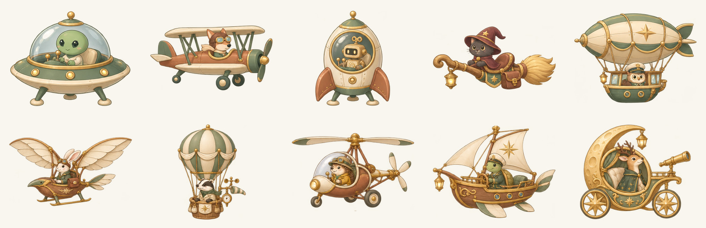
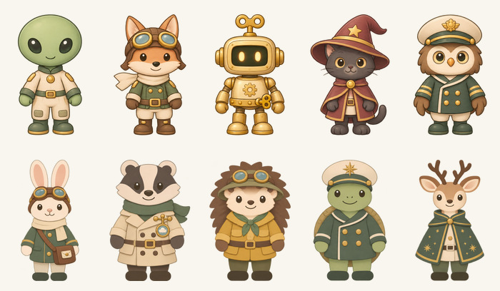
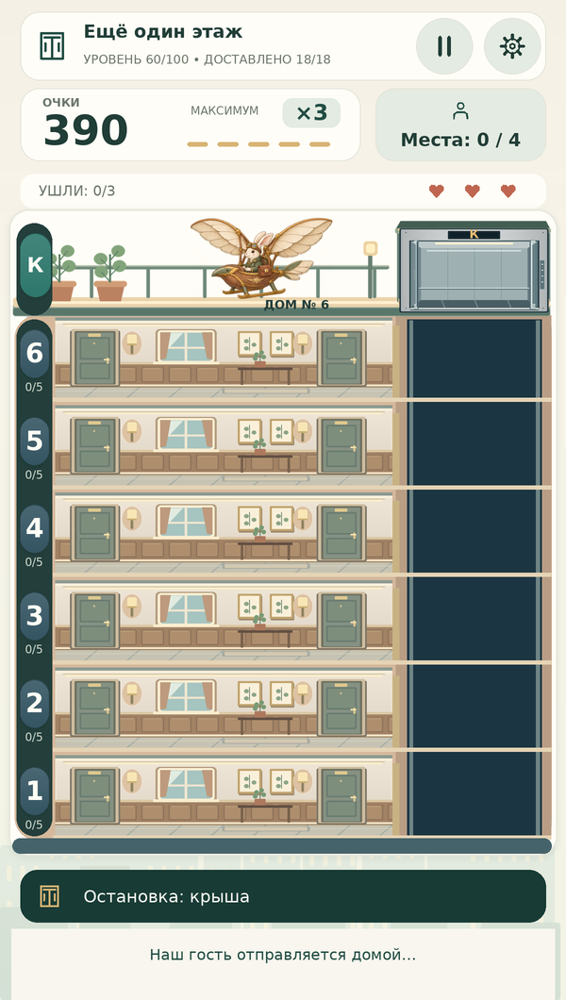

# 100 уровней и новые иллюстрации аппаратов

Кампания расширена с 50 до **100 уровней**. Все пять прежних аппаратов заменены более подробными иллюстрациями; добавлены пять новых пар «гость + аппарат». Все десять финальных персонажей получили согласованные изображения для очереди, кабины и посадки.

## Что изменилось в рисунках

Переработаны тарелка, биплан, ракета, метла и дирижабль. У аппаратов цельные силуэты, соединённые стойки и подвесы, проработанные кабины, обивка, крепления, швы, металлические ободы и небольшие детали в кремовой, шалфейной, медной и золотистой палитре. Новые аппараты продолжают эту систему материалов.

Главное исправление посадки: раньше маленькая фигура накладывалась поверх аппарата в отдельном прямоугольнике. Теперь у каждого аппарата **два полных согласованных спрайта** — пустой и с правильно сидящим пассажиром. Корпус и кабина естественно закрывают нижнюю часть фигуры. Обе картинки имеют одинаковый размер холста и опорную линию. В конце подхода за 180 мс появляется изображение занятого аппарата, затем начинается отлёт. Пропорции берутся из реальных размеров спрайта; аппараты привязаны к общей точке посадки на крыше, без растягивания.

Иллюстрации подготовлены генерацией изображений и отобраны визуально; обрезка, единые холсты и экспорт выполнены ImageMagick. В игре используются готовые локальные PNG, никаких запросов генерации или дополнительных пакетов во время игры нет. Старый генератор геометрических заглушек аппаратов удалён, чтобы случайно не вернуть прежние рисунки. `Tools/import_finale_art.sh` документирует извлечение двух состояний из исходных атласов и подготовку метаданных; для запуска игры он не нужен.

## Все финальные пары

| Уровень | Последний пассажир | Аппарат |
|---|---|---|
| 10 | Инопланетянин | Летающая тарелка |
| 20 | Лис-пилот | Винтажный биплан |
| 30 | Заводной робот | Ретро-ракета |
| 40 | Кот-чародей | Волшебная метла с седлом |
| 50 | Сова-капитан | Дирижабль с гондолой |
| **60** | **Заяц-почтальон** | **Орнитоптер с шарнирными крыльями** |
| **70** | **Барсук-метеоролог** | **Воздушный шар с корзиной и метеоприборами** |
| **80** | **Ёж-исследователь** | **Автожир с верхним ротором** |
| **90** | **Черепаха-штурман** | **Летающий деревянный парусник** |
| **100** | **Олень-астроном** | **Лунная колесница с телескопом** |

Между десятью финалами не повторяются ни персонаж, ни аппарат. Каждый аппарат ждёт на крыше с начала соответствующего уровня. Его гость появляется гарантированно последним, когда остальные уже доставлены, едет на крышу, садится и улетает. У новых пар свои траектории отлёта.

Гость входит в обычную цель уровня, занимает одно место и приносит обычную доставку и очки. При уходе заменяется тем же персонажем. Рекламное спасение сохраняет того же третьего пассажира и восстанавливает 30% терпения. После финала лишних пассажиров не остаётся. Прогресс и рекорд записываются до короткой анимации; затем появляется прежнее окно победы с мягким звуком и конфетти.

## Спокойная вторая половина кампании

Уровни 51–100 чередуют смешанные, короткие, дальние поездки, волны и переезды. Разнообразие создаётся маршрутами, названиями и гостями, без постоянного ускорения:

- Цель — **18–22 пассажира**; финальный гость уже включён в это число.
- Терпение — **170–206 секунд**; внутри лифта оно по-прежнему не расходуется.
- Одновременно активны максимум **5–6 человек**, включая пассажиров в кабине.
- Базовый интервал — примерно 4 секунды, у волн длиннее; пустой дом пополняется быстро.
- Коробки — 12%, в переездах 24%.
- Резерв на действительные уходы — прежние три человека; запас не создаёт лишнюю толпу в конце.

[Полная таблица 100 уровней](Docs/LEVELS.md) сформирована непосредственно из `Campaign.CreateLevels()`.

Исходные настройки уровней 1–50 сохранены. Старый прогресс 50/50 автоматически открывает 51-й. Список теперь состоит из 20 страниц; после 50-го предлагается 51-й, завершение всей кампании перенесено на 100-й. Собственные изменения баланса, язык, звук, монеты, коллекция, рекорды и настройки рекламы сохраняются. Каталог содержит 303 записи на семи языках; китайские шрифты дополнены с сохранением GUID и лицензии.

## Проверки этого обновления

- **4 216 проверок логики .NET**, включая 100 уровней, перенос старой кампании, все десять финалов, замену/спасение каждого гостя и прежние проверки экономики, рекламы, очередей и редких пассажиров.
- **5 000 / 5 000** прохождений всей кампании простым водителем с реакцией 1.25 секунды.
- Дополнительно **1 000 / 1 000** прохождений уровней 51–100 с реакцией 2.5 секунды и периодической задержкой 6 секунд: **0 потерянных пассажиров**, среднее время **103.3 с**, максимум **148.2 с**. Это симуляция запаса проходимости, не оценка увлекательности человеком.
- **540** полных сценариев десяти финальных уровней с 0/1/2 потерями; отдельно проверены замена и рекламное спасение каждого последнего гостя.
- **150 проверок UI с заменителями SDK**: правильные пустые/занятые спрайты, посадка, разные траектории, сохранение до отлёта, единственная победа и конфетти, переход 50 → 51 и последняя страница 100-го уровня, сохранение пользовательских настроек и рекламы.
- **110 проверок геометрии UI**, без изменений механики колеса.
- Синтаксис C# 9: **43 файла × 5 конфигураций**, ошибок 0. Компиляция исполняемых проверок .NET и диагностического средства предпросмотра успешна.
- **121 RGBA PNG**, метаданные, **180 уникальных GUID**, десять согласованных пар состояний аппаратов. Четыре шрифта содержат необходимые символы, включая 530 китайских.
- **2 058 вариантов исходной раскладки**: семь языков × три вертикальных экрана (600×1060, 360×800, 390×844 с вырезами), включая десять финалов и страницы новой кампании. Проверены метрики **52 248 текстовых прямоугольников**, кандидатов на переполнение 0.

[Уровни 96–100](Docs/Hundred/campaign-page20-current.png) · [Окно победы на 100-м уровне](Docs/Hundred/level100-victory.png)

## Предпросмотр и пределы проверки

В папке [Docs/Hundred](Docs/Hundred) находятся иллюстрации ресурсов и диагностические изображения из фактического C# интерфейса. Они используют реальные PNG, позиции и шрифты, но **не являются скриншотами Unity**. Маски, повороты, ввод и жизненный цикл воспроизводятся лишь частично. Эти изображения просмотрены для проверки сочетания новых аппаратов с домом и размещения элементов.

Unity Editor и Android SDK в рабочей среде отсутствуют. **Импорт Unity, генерация SDF, Play Mode, настоящий звук, Android APK/AAB, производительность и человеческий плейтест не выполнены.**

Для запуска распакуйте весь архив и откройте `OPEN_GAME.cmd` в Windows при установленном Unity 6000.6.7f1. Сцену пересоздавать не нужно. В Unity проверьте: старый прогресс открывает 51-й; все десять аппаратов целиком видны на крыше; пассажир проходит к месту и появляется внутри аппарата; после отлёта победа срабатывает один раз; 50-й ведёт на 51-й, 100-й возвращает в список. Оцените спокойный темп новых уровней на телефоне.
