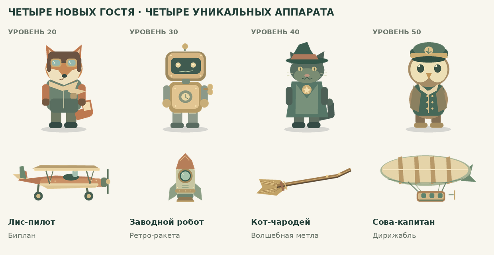
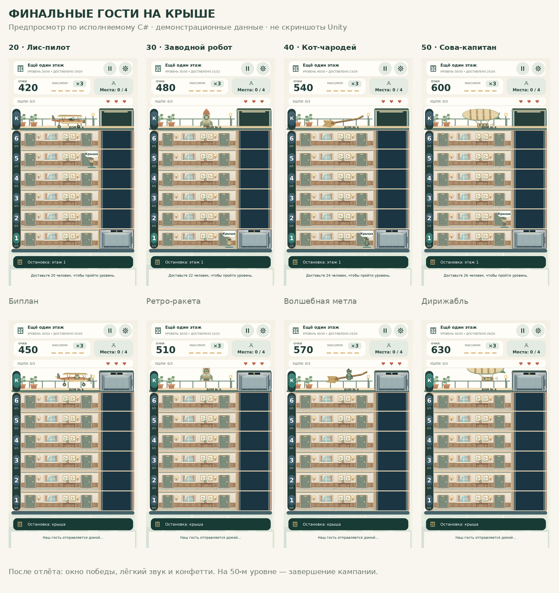

# Пять уникальных финалов на крыше

> Архив предыдущего этапа. Актуальные 100 уровней, новые рисунки аппаратов и проверки — в [UPDATE-100-LEVELS-RU.md](UPDATE-100-LEVELS-RU.md).

Добавлены четыре финальных пассажира и четыре самостоятельных летательных аппарата. Финал десятого уровня сохранён.

| Уровень | Последний пассажир | Летательный аппарат | Отлёт |
|---|---|---|---|
| 10 | Инопланетянин | Летающая тарелка | Плавно поднимается по диагонали |
| 20 | Лис-пилот | Биплан | Разгоняется вправо и набирает высоту |
| 30 | Заводной робот | Ретро-ракета | Уходит вертикально вверх |
| 40 | Кот-чародей | Волшебная метла | Взлетает по мягкой дуге с наклоном |
| 50 | Сова-капитан | Дирижабль | Неторопливо поднимается и дрейфует |



Все новые персонажи и аппараты нарисованы отдельно в существующей тёплой палитре. Биплан имеет два крыла, стойки и пропеллер; ракета — высокий корпус, иллюминатор и стабилизаторы; метла — деревянную рукоять и связку соломы; дирижабль — полосатый баллон, подвесы и гондолу. Используется восемь новых PNG, без покупки ассетов и новых пакетов. Посадочное место и пропорции настроены для каждого аппарата, а пассажир виден на борту после посадки.

## Как работают финалы

На каждом из уровней 10/20/30/40/50 соответствующий аппарат ждёт на крыше с начала попытки. После доставки остальных появляется гарантированный последний гость. Его нужно забрать с жилого этажа и отвезти на крышу. Он выходит из лифта, проходит к аппарату, занимает место и улетает. Затем показывается победа с прежними конфетти и мягким звуком. На пятидесятом уровне остаётся финальное окно завершения всей кампании.

Персонажи и аппараты между этими пятью уровнями не повторяются. Специальные гости не участвуют в обычной случайной генерации и не появляются на других уровнях. Каждый занимает одно место, приносит одну доставку и обычные очки. Общее задание уровня не увеличивается; финальный гость входит в его цель. После победы лишних пассажиров не остаётся.

Уходы и реклама работают как раньше: резерв ограничен тремя заменами; если финальный гость уходит, заменяется тем же сюжетным персонажем. При третьем уходе рекламное продолжение сохраняет того же пассажира и восстанавливает 30% терпения. Победа, рекорд и прогресс сохраняются до анимации отлёта. Переигрывание уровня снова показывает его собственную пару.

В описании соответствующего уровня теперь указаны имя гостя и его аппарат. Все новые подписи переведены на семь языков. Китайские шрифтовые подмножества дополнены с сохранением OFL-лицензии и GUID.



[Финальный экран уровня 50](Docs/Finales/level50-victory.png)

## Проверки

- **2 618 проверок .NET**: прежние игровые сценарии плюс 347 новых проверок каталога и пяти финалов. В новых проверках — 270 полных прохождений пяти специальных уровней с 0/1/2 заменами; спасение и замена каждого финального гостя; версии уровней с целью в одного пассажира; отсутствие сюжетных гостей на всех остальных 45 уровнях; отдельные идентификаторы персонажей и аппаратов. Кампания также прошла 4 425 807 кадров симуляции; 64 551 стресс-кадр выполнен.
- **98 проверок UI с заменителями SDK**: привязка нужной модели и аппарата к каждому уровню, ожидание на крыше с начала, появление нужного гостя на борту, сохранение до отлёта, разные траектории, однократная победа/звук/конфетти и завершение кампании на 50-м уровне. Прежние состояния кнопок, звук и реклама также проверены.
- **110 проверок геометрии** существующих UI-поверхностей, иконок и колеса. Roslyn: **43 файла C# × 5 конфигураций**, синтаксических ошибок нет.
- **101 PNG** и **160 уникальных GUID** проверены вместе с импортерами и метаданными. Четыре шрифта покрывают все 188 Latin/Cyrillic/symbol и 465 CJK-символов каталога. Всего **243 записи × 7 языков**.
- **1 176 вариантов разметки**, 30 261 текстовая область, кандидатов на переполнение по метрикам включённых шрифтов не найдено. Включены описания и все фазы пяти финалов на обычном, узком и снабжённом вырезом экранах.
- Цена и вероятности колеса, обычные персонажи, шанс енота 4%, шанс динозавра 0.5%, сохранения косметики, рекламный backend, геометрия шести жилых этажей и OPEN_GAME.cmd не менялись.

**Unity Editor и Android toolchain в этом окружении отсутствуют.** Полная сборка Unity/Android, импорт в настоящий Editor, Play Mode, сенсорный ввод, звук на устройстве и производительность не проверены. Превью построены из выполняемого C# с заменителями Unity/TMP API и демонстрационными данными. Они не воспроизводят настоящий SDF-рендер, поворот спрайтов, шейдеры и жизненный цикл Unity в полной мере.

## Открытие и ручная проверка

Распакуйте новый ZIP целиком и запустите **OPEN_GAME.cmd**. Нужен Unity **6000.6.7f1**. Существующие сохранения и собственные настройки уровней сохраняются. Уже открытые уровни 10/20/30/40/50 можно переиграть.

В Unity проверьте все пять уровней: нужный аппарат стоит с начала; обычные пассажиры заканчиваются перед финальным; последний гость имеет нужную модель и едет на крышу; двери открываются перед выходом; нужный персонаж садится в аппарат; каждый аппарат улетает своим движением; победа появляется один раз; на уровне 50 показывается завершение кампании. Проверьте также замену последнего пассажира, продолжение за рекламу, выключение звука, длинные переводы и safe area.

Воспроизводимые команды из корня проекта (.NET 8 и Python с Pillow/fontTools):

```sh
dotnet run --project Tests/LogicTests.csproj
dotnet run --project Tests/UIPresentation/UIPresentation.csproj
dotnet run --project Tests/WheelGraphics/WheelGraphics.csproj
dotnet run --project Tests/SourceChecks/SourceChecks.csproj
python Tools/check_art.py
python Tools/check_typography.py
python Tools/UIReview/matrix.py /tmp/omf-finales --finales
python Tools/UIReview/check_text.py /tmp/omf-finales
python Tools/UIReview/render.py /tmp/omf-finales/normal-ru /tmp/omf-finale-previews
```

Каталог RooftopFinales задаёт неизменяемые пары уровней, персонажей и аппаратов. Условия появления, награда и резерв используют общую логику; RoofView отвечает только за представление и отлёт. Дополнительные флаги и копии механики для каждого уровня не создавались.
