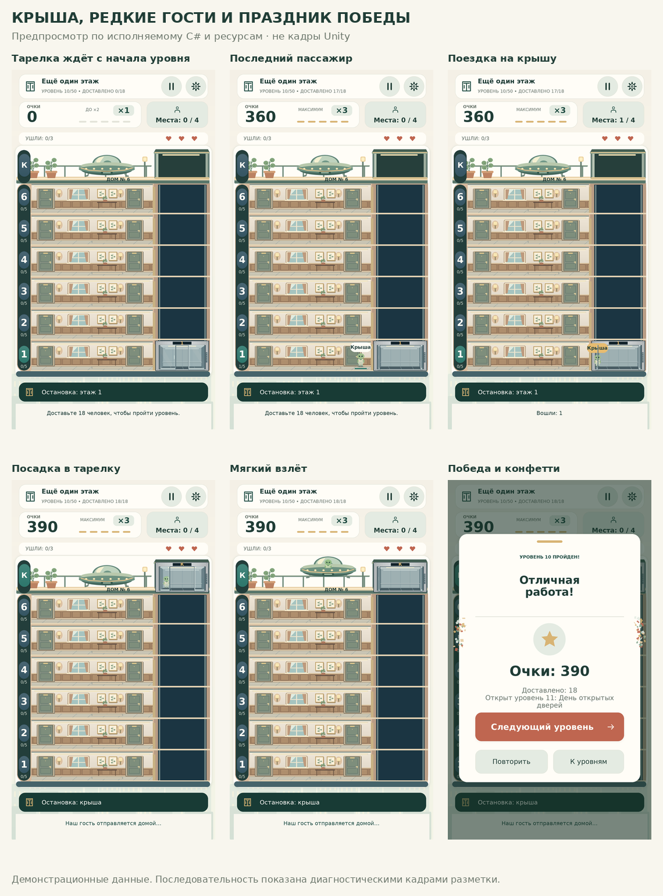
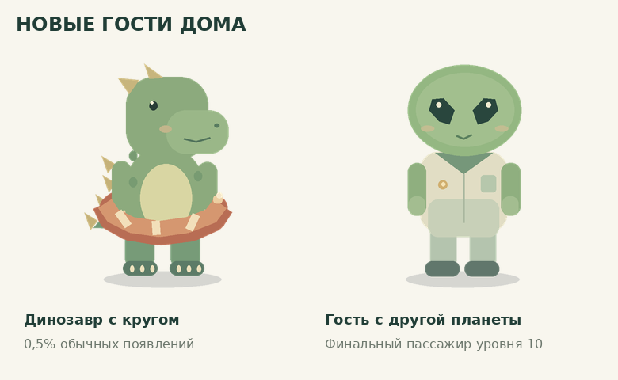

# Крыша, редкие гости, звук и празднование победы

В игру добавлены новые персонажи, седьмая остановка лифта и финал десятого уровня. Обновление продолжает предыдущую полировку интерфейса.



## Плашки и конфетти

- Общие модальные окна проявляются за 300 мс, увеличиваясь с 0.965 до 1 без пружины и скачка. Затемнение также проявляется плавно, закрытие занимает 160 мс. Интерактивность доступна сразу.
- Рекламные уведомления получили мягкий вход и выход, при прежнем общем времени жизни 2.8 секунды. Плавно появляются учебная карточка, панель результата колеса и подписи после доставки.
- Вместе с окном победы с двух сторон вылетает 64 небольших кусочка конфетти в золотых, кремовых, зелёных и терракотовых оттенках. Это одна небольшая UI-сетка; эффект не перехватывает касания, плавно исчезает и удаляется через 2.65 секунды. Рисунок частиц использует собственный детерминированный хеш и не влияет на случайные игровые награды или пассажиров.

## Новые звуки

При настоящем прибытии движущегося лифта звучит мягкий двухтональный звонок. Повторное нажатие текущего этажа не создаёт дополнительных звонков. Победа сопровождается лёгким воздушным шорохом и коротким мелодичным переливом. Хлопка, взрыва и резкого импульса нет.

Оба звука синтезируются локально из оригинального кода CozySound. Загрузок аудио, сторонних платных материалов и новых пакетов нет. Новые сигналы подчиняются существующему переключателю звука; выключение звука останавливает и их. Проверены длительность, конечность PCM, запас до клиппинга и плавность атаки/затухания. Реальное прослушивание через Unity и динамик телефона в этом окружении не выполнялось.

## Персонажи



**Динозавр в плавательном круге**: 0.5% обычных случайных появлений, на любом уровне. Он занимает одно место, приносит обычные очки и считается одним доставленным пассажиром. Коробка не перекрывает круг. Енот по-прежнему имеет шанс 4%; вероятности не накладываются друг на друга.

**Зелёный инопланетянин**: по уточнению пользователя появляется **только на уровне 10 и гарантированно последним**. Случайного шанса 0.1% на других уровнях нет. Обычная генерация останавливается за одну доставку до цели. После доставки всех присутствующих появляется финальный гость, которому нужна крыша. Он также даёт одну доставку и обычные очки.

Если финальный гость уходит, применяется прежний резерв замен: следующим снова будет финальный инопланетянин. При третьем уходе остаётся обычное предложение продолжить за рекламу с восстановлением 30% терпения. Новая механика не создаёт лишнюю очередь после победы.

## Крыша и финал уровня 10

Крыша видна на всех уровнях как терраса с ограждением, растениями, фонарём и открытой надстройкой шахты. Это отдельная остановка над шестым этажом: кнопка **«К»** в русском интерфейсе. Нажать можно также на посадочную площадку. На ранних уровнях доступность жилых этажей сохраняется; остановка на крыше доступна отдельно. Шесть жилых очередей и их лимиты сохранены, случайные пассажиры на крыше не создаются.

Чтобы освободить место, HUD стал компактнее; высота обычных этажей уменьшилась примерно на 4%, исходные интерьерные изображения, координаты горизонтальных мест и вместимость сохранены. Табло и строка маршрута различают крышу и жилые этажи. Подписи добавлены на всех семи языках; китайские шрифтовые подмножества дополнены двумя символами с сохранением OFL-лицензии и GUID.

На уровне 10 тарелка ждёт с самого начала. Последнего пассажира нужно забрать с жилого этажа и отвезти наверх. Он выходит из открывшегося лифта, проходит к тарелке, занимает место под стеклянным куполом, после чего тарелка плавно поднимается и исчезает из вида. Затем появляются окно победы, конфетти и звук. Прогресс и рекорд сохраняются **до** этой короткой визуальной сцены, поэтому её прерывание не отменяет победу.

## Проверки

- **2 271 проверка .NET**: прежняя игровая логика, кампания, локализация, косметика и реклама, а также 97 новых проверок крыши/финального гостя/аудио и дополнительная статистическая проверка динозавра. Включены 72 полных прохождения уровня 10 с 0/1/2 заменами, спасение последнего инопланетянина, отсутствие инопланетян на других уровнях, нормальный счёт и точный диапазон вероятности 50 из 10 000 значений. Всего проверено 4 403 691 кадров кампании и 64 551 стресс-кадр.
- **64 проверки UI с заменителями SDK**: монотонное появление окна без перепрыгивания, полный переход игрового приложения через посадку/отлёт/победу, сохранение прогресса до сцены, однократный звук, выключение звука, небольшая корректная сетка конфетти, состояния кнопок и рекламный таймер.
- **110 проверок геометрии** поверхностей, иконок и неизменённого колеса.
- Roslyn: **42 файла C# × 5 конфигураций**, синтаксических ошибок нет. Сборка тестов .NET с заменителями Unity/TMP API успешна.
- **93 PNG**, импортеры, **151 уникальный GUID** и метаданные проверены. Четыре шрифта покрывают 188 Latin/Cyrillic/symbol и 452 CJK-символа. Каталог содержит 232 записи × 7 языков.
- Диагностическая разметка: **567 вариантов**, 15 435 текстовых областей, кандидатов на переполнение по метрикам включённых шрифтов не найдено. Проверены обычный портретный экран, узкий 360×800 и 390×844 с вырезом. Это оценка компоновки, не рендер TMP.
- Механика колеса, редкости, экономика, сохранения косметики, рекламный backend и OPEN_GAME.cmd не изменялись.

**Unity Editor и Android toolchain здесь отсутствуют.** Полная компиляция с настоящими Unity API, импорт ассетов/SDF, Play Mode, звучание, касания, шейдеры и производительность на телефоне не проверены. Изображения в этом документе — диагностический предпросмотр из фактического C# с заменителями API и демонстрационными данными, а не кадры Unity.

## Открытие и ручная проверка

Полностью распакуйте свежий ZIP и запустите **OPEN_GAME.cmd**. Нужен Unity **6000.6.7f1**. Сцена и собственный GameSettings не требуют ручного пересоздания. Существующие незавершённые записи прогресса не сбрасываются; пройденный уровень 10 можно переиграть.

В редакторе и на телефоне проверьте: плавное появление паузы/победы/уведомлений; отсутствие резкого звука; один звонок на реальное прибытие; выключение всех новых звуков; поездку на крышу и обратно на раннем уровне; тарелку с начала уровня 10; появление последнего инопланетянина только после остальных; посадку, взлёт и последующую победу; касания сквозь конфетти; шрифты и safe area на разных устройствах. Для реального рекламного спасения по-прежнему нужен настроенный SDK.

Воспроизвести доступные проверки из корня проекта (.NET 8, Python/Pillow/fontTools):

```sh
dotnet run --project Tests/LogicTests.csproj
dotnet run --project Tests/UIPresentation/UIPresentation.csproj
dotnet run --project Tests/WheelGraphics/WheelGraphics.csproj
dotnet run --project Tests/SourceChecks/SourceChecks.csproj
python Tools/check_art.py
python Tools/check_typography.py
python Tools/UIReview/matrix.py /tmp/omf-roof-layouts --rooftop
python Tools/UIReview/check_text.py /tmp/omf-roof-layouts
python Tools/UIReview/render.py /tmp/omf-roof-layouts/normal-ru /tmp/omf-roof-previews
```
