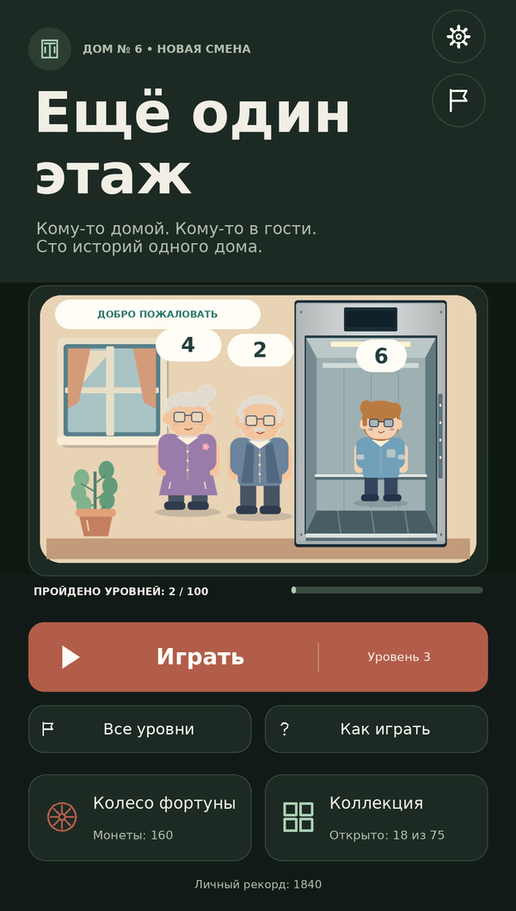
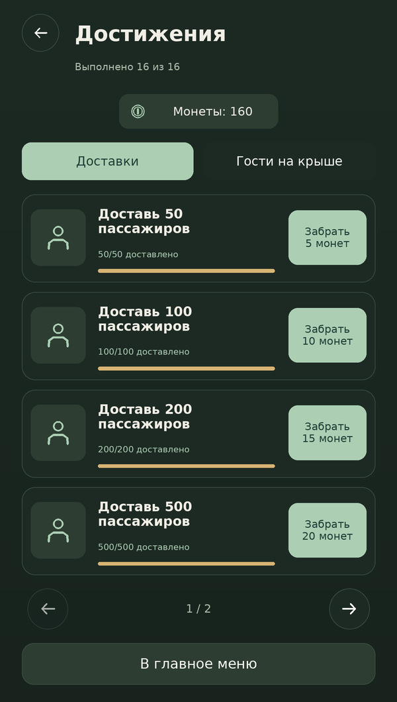

# Светлая и тёмная темы, достижения

В настройках появился переключатель **«Тёмная тема»**. В главном меню шестерёнка поднята, под ней расположена круглая кнопка с флажком. Она открывает список достижений; терракотовый значок **!** показывает, что есть незабранные награды.

## Две согласованные палитры

Светлая тема остаётся начальной. Тёмная использует почти чёрный зелёный фон `#111A17`, поверхности `#1D2A24`, молочный текст `#F1EEE5`, приглушённый светлый текст и мягкий зелёный акцент. У основного действия сохранён терракотовый цвет; оттенок немного углублён для читаемости небольших надписей. Монеты и награды остаются золотистыми.

Тема применяется к главному меню, выбору уровней, коллекции, HUD, настройкам, обучению, окнам паузы/победы/поражения и достижениям. У колеса сохранён его тематический зелёный фон; надписи на нём используют отдельный светлый цвет. Цвета иллюстраций дома, лифта, персонажей и аппаратов сохранены.

Выбор темы записывается на устройстве и восстанавливается при запуске. Смена темы во время игры сохраняет текущую поставленную на паузу сессию, маршрут, пассажиров, терпение и время. После закрытия настроек игрок возвращается к явной кнопке продолжения. Смена языка сохраняет выбранную тему.

## 16 отдельных достижений

Общий счётчик суммирует реально доставленных людей между уровнями, повторами и запусками игры. Енот, динозавр, пассажир с коробкой и сюжетный гость считаются каждый за одного. Посадка, ожидание и уход не увеличивают счётчик. Последняя доставка, завершающая уровень, учитывается.

| Доставлено людей | Награда |
|---:|---:|
| 50 | 5 монет |
| 100 | 10 монет |
| 200 | 15 монет |
| 500 | 20 монет |
| 1000 | 25 монет |
| 2000 | 30 монет |

Ещё десять достижений — доставить на крышу пришельца, лиса-пилота, робота, кота-чародея, сову-капитана, зайца-почтальона, барсука-метеоролога, ежа-исследователя, черепаху-штурмана и оленя-астронома. Каждое приносит **5 монет** и связано со своим уровнем 10–100. Условия выполнены при фактическом прибытии пассажира на крышу. Повтор финала сохраняет уже полученное достижение.

У списка две категории: «Доставки» и «Гости на крыше», четыре карточки на странице. Каждая показывает название, прогресс и награду. После выполнения появляется кнопка **«Забрать»**. Награда выдаётся один раз; после получения карточка меняет состояние. Всего за все достижения можно получить **155 монет**.

При выполнении достижения на игровом экране сверху плавно выезжает плашка с флажком, названием и размером награды. Несколько выполненных условий показываются по очереди. Плашки не перехватывают нажатия и не закрывают игровое поле; пауза временно скрывает уведомление и сохраняет остаток времени показа. После выхода в меню уведомление убирается, а **!** остаётся до получения всех доступных наград.

**Общий счётчик начинает вести историю с этого обновления: в предыдущих версиях общего количества доставок не сохранялось.** Пройденные уровни, рекорды, монеты, открытые оформления, выбор оформления и рекламный таймер переносятся.

## Сохранение наград

Баланс монет, коллекция, рекламный таймер, счётчик доставок и полученные достижения сохраняются одним снимком `OneMoreFloor.Account.v1`. Это связывает выдачу монет с отметкой о получении: повторное нажатие или перезапуск не создают вторую награду. Старый снимок `OneMoreFloor.Cosmetics.v1` читается при переносе и сохраняется как был. Последующие операции колеса и коллекции используют новый общий снимок.

Режим тестовых вращений в редакторе сохраняет отдельность демонстрационного баланса: монеты из него не переносятся в настоящий кошелёк при получении достижения. Пауза, проигрыш, рекламное продолжение, правила доставок и вероятность наград колеса сохраняют свою механику.

## Проверки и предпросмотр

- **4 304 проверки логики .NET**, включая 88 проверок достижений: пороги, все 10 гостей, сохранение, миграцию, повторные нажатия и точные суммы наград. Прежние проверки 100 уровней и рекламы прошли.
- **212 проверок интерфейса с заменителями SDK**: смена и сохранение темы, сохранность паузы и пассажиров, все реальные финалы, последняя доставка, коробка/енот/динозавр, получение наград, индикатор, последовательные плашки, режим тестового колеса и области нажатия новых круглых кнопок.
- Для обеих тем проверена контрастность основного, второстепенного текста и текста кнопок: не менее **4.5:1** в проверенных сочетаниях палитры.
- **116 проверок геометрии UI**, включая новые значки солнца и луны.
- Синтаксис C# 9: **45 файлов × 5 конфигураций**, ошибок 0.
- **1470 вариантов раскладки**, семь языков, две темы и три вертикальных экрана: 600×1060, 360×800, 390×844 с безопасными отступами. **40 782 текстовых прямоугольника**, кандидатов на переполнение по метрикам шрифтов 0.
- **121 RGBA PNG**, **182 уникальных GUID**; четыре шрифта покрывают все требуемые символы. Каталог — 326 записей на семи языках.

Изображения в [Docs/Themes](Docs/Themes) получены диагностическим средством из фактического C# интерфейса, ресурсов и метрик шрифтов. Это **предпросмотры исходной раскладки, не скриншоты Unity**. Просмотрены обе темы, настройки, достижения, уведомление, полный лифт и колесо.

Unity Editor и Android SDK в этой среде отсутствуют. Импорт проекта в Unity, Play Mode, поведение на настоящем сенсорном экране и сборка APK/AAB здесь не выполнялись.

Распакуйте весь архив и откройте `OPEN_GAME.cmd` при установленном Unity 6000.6.7f1. Сцену пересоздавать не требуется. Для ручной проверки смените тему в меню и на паузе, перезапустите игру, доставьте 50 пассажиров, получите награду и повторно откройте список; затем проверьте уведомление на любом из десятых уровней.
