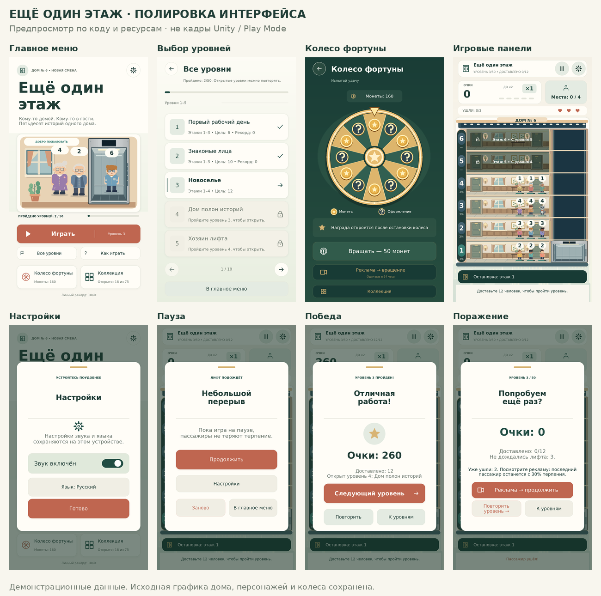

# Визуальная полировка «Ещё один этаж»

Изменения внесены в Unity uGUI/TMP-интерфейс. Сохранены уютная палитра, существующие шрифты, иллюстрации и обработчики действий.



**Эти изображения построены из выполняемого C# с заменителями Unity/TMP API. Это не кадры Unity, не проверка Play Mode и не обещание идентичного SDF-рендера на телефоне.** Для предпросмотра используются демонстрационные данные.

[Сравнение меню и уровней до/после](Docs/UI-POLISH-COMPARISON.png) · [Все подготовленные изображения](Docs/Interface)

## Аудит и изменённые компоненты

Прежняя общая фабрика делала почти всем кнопкам одинаковую нижнюю тень, блик и жирную подпись. Карточки, HUD и окна использовали одинаковый визуальный вес, а состояние фокуса не выделялось. В коллекции отдельный обработчик карточки обходил общую систему состояний.

- Общая фабрика GameUI теперь разделяет основное, вторичное, опасное действие, иконочную кнопку, карточку и вкладку. Вместо жёсткого основания и блика — тонкая рамка и деликатная растушёванная глубина там, где она нужна. Информационные панели не получают поведения кнопок.
- UITheme централизует палитру, скругления, типографические роли, тени и длительности. UIShapeImage рисует скруглённую поверхность, рамку, мягкую тень и клавиатурный фокус без новых текстур, пакетов или blur-шейдера. Это наследник Image, поэтому прежние GetComponent<Image> и изменение цвета продолжают работать.
- UIButtonMotion: спокойный hover без увеличения, pressed 0.98, возврат без пружины, отмена нажатия при уходе указателя, фокус клавиатуры и недоступное состояние всего содержимого. После завершения нажатия transform не меняется каждый кадр.
- UIPanelEntrance / UIWindowMotion: появление 0.97 → 1 и opacity 0 → 1 за 220 мс; закрытие за 130 мс. Затемнение настроек и выбора языка также проявляется. Обработчик продолжения игры исполняется сразу, без ожидания анимации. Повторное открытие отменяет незавершённое закрытие.
- Бейджи, полоса прогресса, заголовки секций, уведомления, карточки коллекции и учебные подсказки используют ту же систему. Существующие векторные иконки сохранены; выровнены размеры и цветовые роли. Новые окна не добавлялись.

## Единая дизайн-система

| Элемент | Правило |
|---|---|
| Основной фон / поверхность | #F8F6EE / #FFFDF7; вторичная поверхность #F0EEE4 |
| Текст / основной зелёный | #203D36 / #214D43; приглушённый #6C776C для читаемости |
| Главное действие / награды | Терракота #BF6650 / тёплое золото #D8B474 |
| Тематический тёмный экран | #183B35, спокойные зелёные поверхности и золотые акценты |
| Радиусы | Кнопка 18, малая поверхность 14, карточка 20, окно 24, бейдж 10 единиц Canvas |
| Граница / глубина | Рамка 1; короткая мягкая тень только у приподнятых поверхностей; HUD без тени |
| Типографика | Прежние DejaVu Sans и китайский fallback; выразительные заголовки, обычный вес большинства кнопок и карточек |
| Взаимодействие | Нажатие 120 мс, возврат 150 мс, цвет/фокус 140 мс; без glow и подпрыгиваний |
| Компоновка | Общие поля страницы 5.5%, согласованные парные действия, нормализованные якоря и существующая safe area |

Радиусы указаны в логическом Canvas 600×1060 и масштабируются прежним CanvasScaler. Обычные прямоугольники не превращаются в капсулы; круглая навигация сохраняет свою форму. Золото и особенности окраски редкостей остаются смысловыми акцентами.

## Обновлённые экраны

| Экран | Изменение |
|---|---|
| Главное меню | Цельная терракотовая «Играть» с встроенным номером уровня; равные вторичные действия; парные карточки колеса/коллекции; тонкий прогресс |
| Все уровни | Светлые завершённые и закрытые карточки, спокойные галочки/замки, акцент текущего этапа, компактный разделитель группы, единая навигация |
| Колесо | Компактный кошелёк, лёгкая панель результата, основное платное вращение и отдельное рекламное действие с доступностью и таймером |
| Игровой HUD | Более лёгкая верхняя панель, согласованные очки/места/жизни, компактный множитель, спокойная строка остановки и область задания |
| Коллекция и просмотр предмета | Общие карточки, состояния нажатия/фокуса, вкладки и фильтры; отдельная строка редкости, чтобы «Легендарная» помещалась на узких экранах |
| Настройки / язык | Единые поверхности, кнопки и закрытие; мягкий scrim при смене языка из настроек; первый обязательный выбор остаётся отдельным экраном |
| Пауза / победа / поражение | Общая геометрия и иерархия, мягкое затемнение, основное действие и спокойные вторичные/опасные действия |
| Обучение / описание уровня / объяснение коробок | Общая стилистика окон и типографика; существующие переходы сохранены |
| Подсказки / рекламные уведомления | Более лёгкие информационные поверхности; сохранены место, содержание и время показа |

Сам диск колеса, сегменты, указатель, этажи, лифт, персонажи и расположение игровой области не менялись. Встроенные элементы управления этажами остаются внутри защищённой графики и сохраняют прежнее оформление. UIArtwork ограничивает действие новой фабрики, чтобы общий код UI не изменял иллюстрацию лобби и игровые объекты.

## Отдельный прокрут за рекламу

У колеса две самостоятельные кнопки: **«Вращать — 50 монет»** и **«Реклама → вращение»**. Рекламная кнопка содержит подпись «Один раз в 24 часа». На перезарядке она недоступна и показывает оставшееся время; при недостатке монет платная кнопка становится недоступной независимо от рекламы.

Прежняя проверка завершённого просмотра и сохранённый 24-часовой срок сохранены. Отмена просмотра не списывает попытку. Вероятности, отсутствие повторов и экономика не менялись. Настоящая реклама требует уже предусмотренного подключения SDK и идентификаторов — [REWARDED-ADS.md](Docs/REWARDED-ADS.md).

[Пример рекламного таймера](Docs/Interface/wheel-cooldown.png) · [Пример недостатка монет](Docs/Interface/wheel-no-coins.png)

## Выполненные проверки

- Полный прогон .NET: **2 173 проверки** ядра, кампании, локализации, косметики и рекламных вознаграждений; 4 398 898 кадров кампании и 64 551 стресс-кадр, выход 0. Локализация: 224 записи × 7 языков.
- **110 проверок геометрии** реальных генераторов поверхностей, иконок и колеса: допустимые индексы, конечные координаты, малые/нулевые размеры, границы мягкой тени и перерисовка фокуса/недоступности.
- **51 проверка UI** с заменителями SDK: состояния кнопок, отмена нажатия, восстановление доступности, fade и закрытие окна, повторное открытие, переходы меню/уровня/коллекции/настроек, немедленное продолжение игры, независимость двух кнопок колеса, safe area на 360×640, 360×800, 390×844 и 430×932. Компиляция runtime C# в этой проверке использует заменители, а не настоящие библиотеки Unity.
- Roslyn C# 9: **38 файлов Assets × 5 конфигураций**, включая Editor и условные AdMob Android/iOS; синтаксических ошибок нет.
- 89 PNG декодируются; импортеры, .meta и **143 уникальных GUID** корректны. Четыре шрифта покрывают 186 Latin/Cyrillic/symbol и 450 CJK-символов, включая новый перевод рекламной подписи.
- Разметка 21 варианта экрана × 7 языков × 3 режима viewport: **441 вариант, 12 012 текстовых областей**. У обновлённых UI-компонентов кандидатов на переполнение по метрикам включённых шрифтов не найдено. Есть **28 предупреждений**, все относятся к одному прежнему маленькому табло этажа внутри лифта, повторённому на 4 экранах × 7 языках при вырезе. Оно оставлено без изменений по ограничению на графику игрового поля. Это приблизительная проверка метрик, не измерение TMP на устройстве.
- Сравнение с предыдущей версией: Core, исходные PNG, BuildingView, PassengerView, CosmeticStyle, BuildingLayout, RewardedAdsService и генераторы колеса побайтово не изменены. В записанной разметке совпали все 16 элементов иллюстрации лобби, 120 элементов игрового поля и 15 элементов диска/указателя — координаты, цвета, текстуры и геометрия. `git diff --check` без ошибок.

## Что не удалось проверить

**Unity Editor и Android toolchain в окружении отсутствуют.** Не выполнены импорт проекта и SDF, компиляция с настоящими Unity API, Unity/Android-сборка, Play Mode, настоящий CanvasRenderer, клавиатурный/сенсорный ввод, производительность на телефоне и настоящие рекламные показы. Поэтому изображения обозначены как предпросмотры по коду, а тесты SDK не названы тестами Unity.

После открытия проекта следует проверить четыре основных экрана и все окна в Game View, нажатия/фокус/анимации, длинные переводы и маленькое табло внутри лифта при вырезе. Реальные рекламные сценарии и сохранение таймера после перезапуска проверяются с установленным SDK на устройстве. Файлы открываются прежним **OPEN_GAME.cmd** после полной распаковки архива; версия Unity — **6000.6.7f1**.

## Воспроизводимые команды

Из корня проекта, с .NET 8 SDK и Python/Pillow/fontTools:

```sh
dotnet run --project Tests/LogicTests.csproj
dotnet run --project Tests/WheelGraphics/WheelGraphics.csproj
dotnet run --project Tests/UIPresentation/UIPresentation.csproj
dotnet run --project Tests/SourceChecks/SourceChecks.csproj
python Tools/check_art.py
python Tools/check_typography.py
python Tools/UIReview/matrix.py /tmp/omf-layouts
python Tools/UIReview/check_text.py /tmp/omf-layouts
python Tools/UIReview/render.py /tmp/omf-layouts/normal-ru /tmp/omf-previews
```

Tools/UIReview исполняет фабрики C# с явными заменителями API и строит диагностические изображения. Он не заменяет запуск Unity. Результат анализа метрик сохраняется в `text-fit-report.json` рядом с выгрузками разметки.
