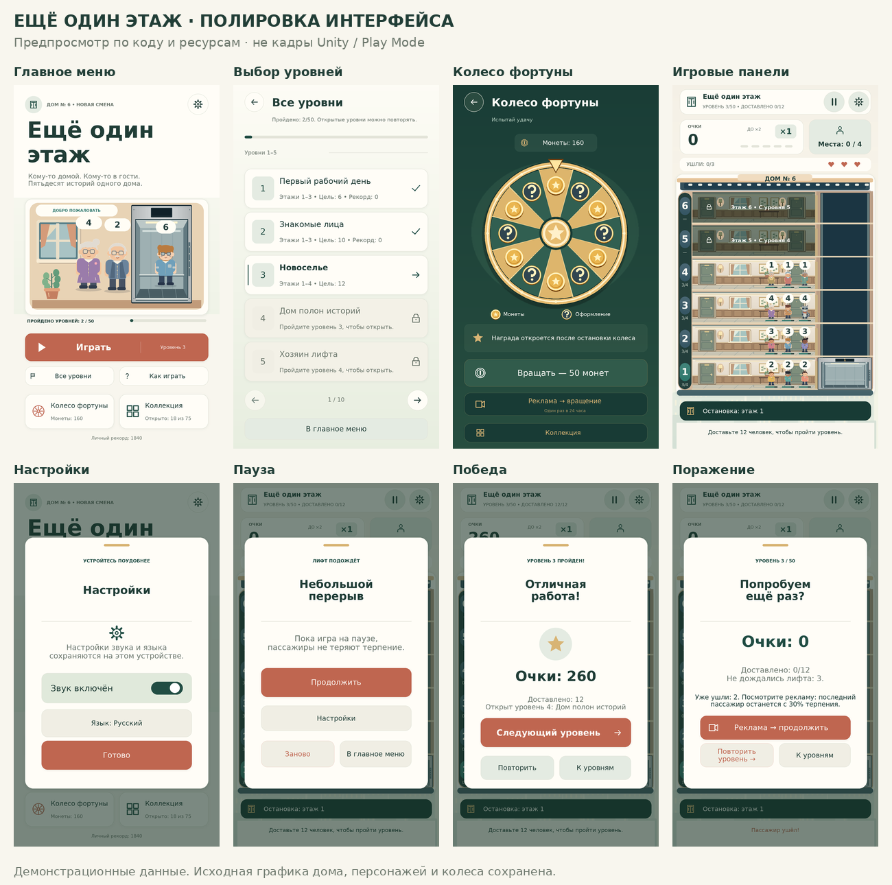

# Новый интерфейс

> Это описание предыдущего этапа. Актуальная полировка, изображения и результаты проверки: [UPDATE-UI-POLISH-RU.md](UPDATE-UI-POLISH-RU.md).

Переработаны главное меню, игровые панели, список уровней, колесо, коллекция, выбор языка, обучение, настройки и окна паузы/результата.



## Что изменилось

- Единая палитра: тёплая бумага, светлые поверхности, глубокий зелёный, терракотовый акцент и золото. Разделены заголовки, основной текст и второстепенные подписи; выровнены поля, интервалы и размеры элементов.
- Главное меню с отдельной иллюстрацией лобби, заметной кнопкой «Играть», меткой следующего уровня, прогрессом кампании и удобными переходами в колесо, коллекцию и обучение. «Играть» открывает описание следующего доступного уровня; список всех уровней доступен рядом.
- Кнопки получили аккуратный нижний край, лёгкий блик, состояния наведения/нажатия/недоступности и короткую анимацию нажатия. Интерфейсные нажатия используют существующий тихий звук, подчинённый настройке звука. После окончания анимации кнопка перестаёт менять transform каждый кадр.
- Карточки и модальные окна используют общие скругления и тонкие тени. При открытии окна плавно проявляются. Новые векторные значки рисуются в собственном разрешении Canvas и не требуют внешних изображений.
- Игровые панели сгруппированы: уровень и прогресс сверху, отдельные счёт/серия/вместимость, три сердца оставшихся попыток, аккуратная нижняя строка маршрута. Закрытые этажи имеют читаемую подпись и значок замка. Контраст фона под интерфейсом стабилизирован для выбранных оформлений.
- Колесо оформлено в глубоких зелёных и золотых тонах. Баланс, результат и две кнопки вращения разделены по значимости. Подписи с вероятностями над колесом нет. Платное и рекламное вращения работают по прежним правилам.
- Коллекция получила крупные карточки с превью, отдельные вкладки категорий/редкости, заметный выбранный предмет и страницы. В обычной редкости 10 предметов разделены на две страницы; остальные редкости помещаются на одну. Нажатие карточки открывает увеличенный просмотр, откуда можно выбрать уже открытый предмет.
- Список уровней показывает отдельные номерные плитки, текущий уровень, завершённые и закрытые этапы. Окно победы — со значком награды и одной основной кнопкой следующего уровня.
- Обновлены выбор языка, дополнительные подписи и китайские шрифтовые подмножества. Настройки и прогресс игрока сохраняются.

## Открытие

Полностью распакуйте ZIP и дважды нажмите **OPEN_GAME.cmd** в корневой папке. Нужен установленный Unity 6000.6.7f1. После импорта и подготовки шрифтов нажмите Play.

При обновлении своей рабочей копии перенесите целиком Core, Runtime, Editor и Resources из Assets/OneMoreFloor вместе с .meta. Особенно важны новые PresentationScreens, UISurfaceGraphic, UIIconGraphic, UIButtonMotion и UIPanelEntrance. Сцену и собственный GameSettings.asset заменять не нужно.

## Проверка

- Синтаксис 34 C#-файлов проверяется для пяти наборов символов компиляции, включая Editor и условный AdMob-код Android/iOS.
- Все 94 проверки локализации пройдены: 223 записи × 7 языков, наличие ключей, форматирование и игровые события.
- 88 проверок реальных генераторов сеток: колесо/указатель/награды, скруглённые поверхности и 19 векторных значков в нескольких размерах; координаты, индексы, отсутствие NaN, ограничения мешей и нулевые размеры.
- Для визуальной ревизии C# runtime выполнен с заменителями Unity/TMP API, из фактических фабрик интерфейса выгружены координаты, текст, цвета, ресурсы и треугольники. Построен 21 вариант экрана × 7 языков (147), проверены 3 997 текстовых областей по метрикам включённых шрифтов — кандидатов на переполнение не найдено.
- Проверены 89 исходных PNG, метаданные и 139 уникальных GUID. Шрифты покрывают все требуемые символы.

Изображения в Docs/Interface и общий лист — **предпросмотры из разметки и ресурсов**, а не кадры Play Mode. Заменители API помогают проверить компоновку и вызовы C#, но не воспроизводят Unity SDF/шейдеры, реальный CanvasRenderer, жизненный цикл компонентов и устройство ввода.

**Unity Editor здесь отсутствует.** Импорт, компиляция с настоящими Unity API, нажатия/анимации в Play Mode, звучание на устройстве и Android-сборка требуют проверки в установленном редакторе. Геометрические и шрифтовые проверки не подтверждают FPS или качество SDF на телефоне.

Игровое ядро, награды, шансы редкости, рекламные ограничения и резерв пассажиров в этом обновлении не менялись. Их предыдущие результаты — в UPDATE-ADS-RU.md. Настоящая реклама по-прежнему требует установки AdMob SDK и собственных идентификаторов, см. Docs/REWARDED-ADS.md.

Команды текущей проверки из корня проекта:

```sh
dotnet run --project Tests/LogicTests.csproj -- --localization
dotnet run --project Tests/SourceChecks/SourceChecks.csproj
dotnet run --project Tests/WheelGraphics/WheelGraphics.csproj
python Tools/check_art.py
python Tools/check_typography.py
```
